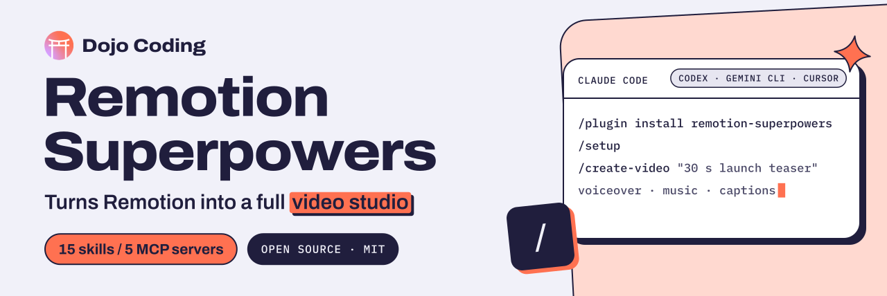

<p align="center">
  <a href="https://dojocoding.io">
    <picture>
      <source media="(prefers-color-scheme: dark)" srcset="docs/assets/banner-dark.svg">
      <source media="(prefers-color-scheme: light)" srcset="docs/assets/banner-light.svg">
      
    </picture>
  </a>
</p>

# Remotion Superpowers

**A free, open-source plugin for builders who make videos with Remotion. Works in Claude Code, Codex, Gemini CLI, and any agent that supports [Agent Skills](https://agentskills.io) + MCP.**

A plugin that turns Remotion from a motion graphics tool into a **full video production studio**.

Gives your coding agent the power to **see** (video analysis), **hear** (music generation), **speak** (voiceovers), **source** (stock footage + AI generation), **caption** (TikTok-style), **transition** (professional scene cuts), and **review** (AI feedback loop) — all wired into Remotion’s React-based video pipeline.

[](https://github.com/DojoCodingLabs/remotion-superpowers)
[](#installation)
[](https://opensource.org/licenses/MIT)
[](https://github.com/topics/claude-code-plugin)
[](https://github.com/DojoCodingLabs/remotion-superpowers)
[](https://github.com/DojoCodingLabs/remotion-superpowers)

[Get started](#installation) · [Commands](#commands) · [API keys](#api-keys-required) · [Contribute](CONTRIBUTING.md) · [Report an issue](https://github.com/DojoCodingLabs/remotion-superpowers/issues/new)

## What This Plugin Does

| Capability | Tool | What It Enables |
|---|---|---|
| 🎵 Music Generation | Suno (via KIE) | Generate background music from text descriptions |
| 🗣️ Voiceovers | ElevenLabs TTS (via KIE) | Generate natural narration from scripts |
| 🔊 Sound Effects | ElevenLabs SFX (via KIE) | Generate sound effects from descriptions |
| 👁️ Video Analysis | TwelveLabs | "See" existing footage — find scenes, detect objects, pick timestamps |
| 📸 Stock Footage | Pexels | Search and download free HD/4K stock video and photos |
| 🖼️ Image Generation | KIE + Replicate | Generate images (FLUX, Imagen 4, Nano Banana Pro) |
| 🎬 Video Generation | KIE + Replicate | Generate video clips (Veo 3.1, Wan, Kling) |
| 📝 Captions | Whisper + @remotion/captions | TikTok-style word-by-word animated subtitles |
| 🎯 Transitions | @remotion/transitions | Fade, slide, wipe, flip, clock-wipe between scenes |
| 🔄 Video Review | TwelveLabs | AI watches your render and gives feedback to improve it |
| 📱 Short-Form | Built-in presets | Optimized pipeline for TikTok, Reels, YouTube Shorts |
| 🎲 3D Content | @remotion/three | Three.js scenes and 3D product showcases |
| 📊 Data Viz | SVG + D3 | Animated charts, dashboards, and number counters |
| ✨ Visual FX | @remotion/light-leaks + CSS | Film grain, vignettes, Ken Burns, Lottie animations |
| 🚀 CI/CD | GitHub Actions | Automated rendering on PR or manual trigger |

## Installation

### Claude Code

```bash
# In Claude Code:
/plugin marketplace add DojoCodingLabs/remotion-superpowers
/plugin install remotion-superpowers@remotion-superpowers
```

That's it. Run `/setup` to configure your API keys.

### Codex

```bash
codex plugin marketplace add DojoCodingLabs/remotion-superpowers
codex plugin add remotion-superpowers@remotion-superpowers
```

Export your API keys in the shell you start Codex from (see [API Keys](#api-keys-required)); the plugin forwards them to the MCP servers. Then ask Codex to run the `setup` skill.

### Gemini CLI

```bash
gemini extensions install https://github.com/DojoCodingLabs/remotion-superpowers
```

Gemini prompts for each API key during install (leave the optional ones blank). Change one later with `gemini extensions config remotion-superpowers "KIE API key"`.

### Cursor, GitHub Copilot, and other agents

```bash
npx skills add DojoCodingLabs/remotion-superpowers
```

This installs the 15 skills into every agent it detects. Then add the MCP servers from [`.mcp.json`](.mcp.json) to your agent's MCP config, and set the API keys listed under each server's `env_vars`.

**Requires:** MCP servers use `npx` and `uvx` — install [Node.js](https://nodejs.org) and [uv](https://astral.sh/uv) if needed.

**What's portable:** skills and MCP servers work in every agent above. The `agents/` subagents and the `hooks/` (API-key guard, captions tip) are Claude Code extras.

### Updating

```bash
# Update the marketplace catalog first:
claude plugin marketplace update DojoCodingLabs/remotion-superpowers

# Then update the plugin:
claude plugin update remotion-superpowers@remotion-superpowers
```

Restart your Claude Code session after updating.

### Local Development

```bash
git clone https://github.com/DojoCodingLabs/remotion-superpowers.git
cd remotion-superpowers

# In Claude Code:
/plugin marketplace add .
/plugin install remotion-superpowers
```

## Quick Start

### 1. Run setup

```
/setup
```

This walks you through:
- Checking dependencies (Node.js, npm, Python, uv)
- Creating or detecting a Remotion project
- Installing Remotion skills
- Configuring API keys for all services
- Verifying MCP server connections

### 2. Create a video

```
/create-video
```

Or just describe what you want:

> "Create a 30-second promo video for a coffee shop. Include drone footage of a city, 
> a warm voiceover, background jazz music, and animated text overlays with the shop's 
> name and address."

## Commands

In Claude Code these are slash commands. In Codex, Gemini CLI and other agents they're skills with the same names: ask for one ("use the create-video skill") or just describe what you want.

### Production
| Command | Description |
|---|---|
| `/setup` | First-run wizard — installs everything you need |
| `/create-video` | Full video production pipeline from concept to render |
| `/create-short` | Short-form vertical video (TikTok, Reels, Shorts) — 9:16, captions, hooks |

### Assets
| Command | Description |
|---|---|
| `/find-footage` | Search & download stock footage from Pexels |
| `/generate-image` | Generate AI images (backgrounds, thumbnails, art) |
| `/generate-clip` | Generate AI video clips (text-to-video, image-to-video) |

### Audio
| Command | Description |
|---|---|
| `/add-voiceover` | Generate and add narration to your video |
| `/add-music` | Generate and add background music |
| `/transcribe` | Transcribe audio/video to text with timestamps |

### Enhancements
| Command | Description |
|---|---|
| `/add-captions` | TikTok-style animated word-by-word captions |
| `/add-transitions` | Professional scene transitions (fade, slide, wipe, flip) |

### Analysis
| Command | Description |
|---|---|
| `/analyze-footage` | Use AI to understand existing video files |
| `/review-video` | AI-powered video feedback loop — render, review, improve, repeat |

## API Keys Required

| Service | Variable | Required? | Cost | What It Provides |
|---|---|---|---|---|
| KIE | `KIE_API_KEY` | ✅ Yes | Paid | Music, SFX, TTS, images, video, subtitles |
| TwelveLabs | `TWELVELABS_API_KEY` | ✅ Yes | Free tier | Video understanding, analysis & review |
| Pexels | `PEXELS_API_KEY` | Recommended | Free | Stock photos & videos |
| ElevenLabs | `ELEVENLABS_API_KEY` | Optional | Free tier | Advanced voice cloning & custom voices |
| Replicate | `REPLICATE_API_TOKEN` | Optional | Pay-per-use | FLUX, Wan, Kling, Veo — 100+ AI models |

## MCP Servers

This plugin auto-configures 5 MCP servers:

- **remotion-media** — Primary media generation (Suno + ElevenLabs + Whisper + more via KIE)
- **TwelveLabs** — Video understanding, scene analysis, and video review
- **Pexels** — Free stock footage and photos
- **ElevenLabs** — Advanced voice features (optional)
- **Replicate** — 100+ AI models for image/video generation (optional)

## How It Works

```
Your Prompt → /create-video (or /create-short)
    │
    ├── 1. Concept    → Break into scenes, script, audio needs
    ├── 2. Script     → Generate narration text + timing
    ├── 3. Voiceover  → Generate TTS audio (remotion-media / ElevenLabs)
    ├── 4. Music      → Generate background music (Suno via remotion-media)
    ├── 5. Footage    → Search Pexels / generate with AI / analyze with TwelveLabs
    ├── 6. Visuals    → Write Remotion React components + transitions + effects
    ├── 7. Captions   → Generate TikTok-style animated subtitles
    ├── 8. Compose    → Wire all assets into composition
    ├── 9. Preview    → npm run dev (live preview)
    ├── 10. Render   → npx remotion render (final MP4)
    └── 11. Review   → /review-video → AI watches & gives feedback → iterate
```

## Project Structure

```
remotion-superpowers/
├── .claude-plugin/               # Claude Code plugin + marketplace manifests
├── .codex-plugin/plugin.json     # Codex plugin manifest
├── gemini-extension.json         # Gemini CLI extension manifest
├── .mcp.json                     # 5 MCP server configurations (shared)
├── skills/                       # 15 Agent Skills (SKILL.md, portable)
│   ├── setup/                    # setup wizard
│   ├── create-video/             # full video production from a prompt
│   ├── create-short/             # TikTok/Reels/Shorts
│   ├── find-footage/  generate-image/  generate-clip/
│   ├── add-voiceover/  add-music/  transcribe/
│   ├── add-captions/  add-transitions/
│   ├── analyze-footage/  review-video/
│   ├── remotion-production/      # production workflow knowledge (18 rules)
│   └── setup-guide/              # setup & troubleshooting knowledge
├── agents/                       # 3 Claude Code subagents
│   ├── video-director.md         # Orchestrates full pipeline
│   ├── media-scout.md            # Finds & evaluates media
│   └── post-producer.md          # Reviews & iterates on quality
├── hooks/hooks.json              # Claude Code pre/post-tool hooks (API key checks, tips)
├── scripts/
│   ├── setup-check.sh            # Dependency validation script
│   ├── check-mcp-server.sh       # Pre-tool API key validation hook
│   ├── post-tool-note.sh         # Post-tool contextual tips hook
│   └── ci/validate.sh            # CI checks (run before opening a PR)
├── CHANGELOG.md
└── README.md
```

## Changelog

See [CHANGELOG.md](CHANGELOG.md).

## Built by Dojo Coding Labs

[Dojo Coding](https://dojocoding.io) is a LATAM-first tech education ecosystem. We build tools for developers and teach people to code.

**remotion-superpowers** is free forever. Open source. MIT licensed.

### More from Dojo Coding

- [CodeSensei](https://github.com/DojoCodingLabs/code-sensei) — Learn to code while you vibecode
- [juan-workflow](https://github.com/DojoCodingLabs/juan-workflow) — Dev lifecycle guardrails
- [VibeCoding Bootcamp](https://dojocoding.io) — Structured curriculum with live mentors

## Contributing

Remotion Superpowers is open source and built to be contributed to. See [CONTRIBUTING.md](CONTRIBUTING.md) for guidelines.

## License

MIT License — free to use, modify, and distribute. Built by [Dojo Coding](https://dojocoding.io).

<p align="center">
  <a href="https://dojocoding.io"></a>
</p>
